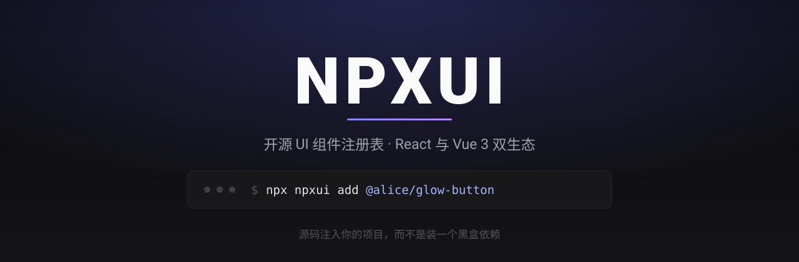

<div align="center">

# NPXUI

**开源 UI 组件注册表 · React 与 Vue 3 双生态**

面向 React 与 Vue 3 / Nuxt 的组件注册表：一行命令把组件的**源码**写进你的项目，而不是让你装一个黑盒依赖；面向 AI 编辑器的 MCP 检索与拉取源码永久免费；基础注册表本地镜像，安装链路不依赖第三方 CDN 是否可达。


[](ROADMAP.md)
[](CONTRIBUTING.md)
[](https://github.com/ithtelab/npxui/issues)

[English](README.en.md) · **简体中文**

<a href="https://github.com/ithtelab/npxui"></a>

</div>

---

## 这是什么

想给项目加一个好看的组件，现在的选择是：要么装一个包，从此被它的 API 绑住；要么在某个组件站上复制源码，然后自己补依赖、改配置、调导入路径 —— 而且下次它更新了，你无从得知。

shadcn/ui 证明了还有第三条路：**注册表**。一份机器可读的源码索引，由命令行把代码直接注入你的项目。代码到手就是你的，随时可改，用完可以彻底脱离注册表。

这个生态很健康，但有两个明显的缺口，本项目就是冲着它们来的：

| 现存缺口 | NPXUI 的做法 |
|---|---|
| **几乎全是 React。** 写 Vue 3 / Nuxt 的人拿不到最好的新组件，只能自己移植或者不用 | 同一份注册表两个生态，`--vue` 拿 Vue 3 版本；优先引入原生 Vue 实现，转译只做兜底 |
| **面向 AI 的那一层正在变收费。** 按次计费、月底清零，就不再算基础设施 | `@npxui/mcp` 的检索与拉取源码永久免费、不限额、不清零 |

一句话概括：**注册表按 shadcn 协议做，Vue 3 当一等公民，AI 接口不设收费墙。**

---

## 与 shadcn 生态的关系

本项目遵循 shadcn 的注册表协议，**不另造格式**：

- **协议层完全兼容** —— 每个组件对外暴露的就是标准 `registry-item.json`，`npx shadcn@latest add <URL>` 同样能装我们的组件
- **基础组件本地镜像** —— 所有 `registryDependencies`（`button` / `card` / `dialog` …）解析到本地镜像，不依赖 `ui.shadcn.com` 或任何第三方资源站是否可达
- **不侵入上游** —— 不要求 shadcn 为我们改一行代码，也不 fork 它的基础组件
- **可以随时离开** —— 装进项目的是纯源码，运行时完全不经过本平台。就算 NPXUI 明天关站，你装过的东西照样跑

---

## 功能亮点

### 检索与预览

- **自然语言搜索** —— `Cmd+K` 输入使用场景而不是关键词，向量检索与关键词混合排序，按安装量加权
- **零卡顿悬停动效** —— 列表页默认静态封面，鼠标悬停播放 60fps 动效视频；封面与视频由后台无头浏览器预录，不是把实时 `iframe` 挂到列表上
- **双主题与响应式** —— 详情页切换亮 / 暗模式，拖拽视口宽度实测断点表现
- **在线 Props 调节** —— 解析 TypeScript 接口自动生成控件，调完直接复制带参数的调用代码
- **体积透明** —— 卡片与详情页标注实测 Gzip 体积，拉入 Three.js 这类重依赖的组件会被预警

### 安装与注入

- **一行命令** —— `npx npxui add @user/comp`，同时也兼容 `shadcn add <URL>`
- **依赖自动安装** —— AST 扫描 import 得出 npm 依赖与基础组件依赖，自动识别你在用 npm / pnpm / yarn / bun
- **配置自动合并** —— Tailwind 扩展与亮暗模式 CSS 变量写进对应文件，而不是丢给你一段说明让你自己改
- **署名随源码落地** —— 版权声明写进文件头，项目根生成 `NPXUI_ATTRIBUTION.md`

### 跨框架

- **Vue 3 / Nuxt 是一等公民** —— `--vue` 参数，原生支持 `shadcn-vue` 协议
- **原生 Vue 源码优先** —— 已经有原生 Vue 实现的组件直接引入，不让你等转译
- **React → Vue 转译兜底** —— 仅对只有 React 版的组件启用，AST + LLM 生成后需通过校验才发布

### AI 接口

- **MCP 永久免费** —— `@npxui/mcp` 接入 Cursor / Windsurf / Claude Code，检索与拉取源码不限额、不清零
- **自带 Key** —— 需要 AI 改写时用你自己的 API Key，平台不做模型转售
- **Prompt 导出** —— 中英双语，深度适配 Cursor / Windsurf / Trae / v0 / Bolt

---

## 当前状态

**本项目处于启动前阶段：npm 上还没有发布任何东西，没有可安装的版本。** 本仓库目前是项目主页，公开的是设计、路线图与共建规则。

上面那些命令的**目标交互效果**大致如下（尚未实现，列在这里是为了让设计可被质疑）：

```bash
$ npx npxui add @alice/glow-button
✔ 检测到 pnpm-lock.yaml，使用 pnpm
✔ 写入 src/components/ui/glow-button.tsx
✔ 写入 src/components/ui/glow-button.helpers.ts
✔ 合并 tailwind.config.ts 中的 keyframes 与 animation
✔ 安装依赖 framer-motion@^11
✔ 生成 NPXUI_ATTRIBUTION.md（原作者署名 + 许可证全文）
✨ 完成。源码已在你项目里，可自由修改。
```

---

## 路线图

| 阶段 | 内容 | 状态 |
|---|---|---|
| **一 · 闭环跑通** | 注册表 JSON 接口、组件详情页、`npxui` CLI、AI Prompt 导出、基础注册表镜像、首批逐源核实许可的组件 | 规划中 |
| **二 · 创作者进场** | `/publish` 在线工作台（Monaco + AST 实时校验 + 实时预览）、独立域名沙盒、三级审核状态机 | 规划中 |
| **三 · 自动运转** | 自动截图与录屏流水线、包体积测算、Props 自动解析、React→Vue 转译、许可证漂移监控 | 规划中 |
| **四 · 生态** | `@npxui/mcp`、创作者激励、开放社区狩猎、垂直专区 | 规划中 |

细则与「明确不做的事」见 [ROADMAP.md](ROADMAP.md)。

---

## 我们不做的事

这部分比功能列表更重要，所以放在前面而不是塞在结尾：

- **不抓取竞争注册表** —— 部分流行组件库的许可明确禁止再分发其源码（Commons Clause、AGPL-3.0，以及禁止再分发源文件的自定义许可）。我们逐源核实，无论多流行都不收
- **不在没有溯源的情况下搬运** —— 每个导入的组件锁定上游 commit SHA，并留存导入当时的许可证全文快照。许可证会变，只记一个仓库地址是不够的
- **不抹除署名** —— 版权声明随源码写进你的项目
- **不把社区注册表做成收费墙** —— 检索、安装、MCP 都不限额，也不存在 Pro 层解锁社区贡献内容
- **不用私有格式绑住你** —— 对外是 shadcn 协议，装过的东西在你项目里，我们消失也照样跑

---

## 参与共建

三种方式，按现在最缺的程度排序：

**① 提名素材源（猎人）** —— 找到一个许可干净的组件库并提名。需要附上仓库里**真实的 LICENSE 文件链接**（不是宣传页），以及它是否提供 shadcn 兼容的注册表端点。判据与拒绝标准写在 [CONTRIBUTING.md](CONTRIBUTING.md)。

**② 投稿组件（创作者）** —— 尤其需要 **Vue 3 / Nuxt** 组件，因为这正是本项目的立项理由。作者身份、主页与安装量统计都归你。

**③ 参与开发** —— 技术栈：Turborepo + pnpm · Next.js 15 App Router · 独立域名沙盒（`esbuild-wasm`）· Playwright 媒体流水线 · Supabase Postgres（含 RLS）。用 `code-interest` 标签开 issue 说明你想做什么。

---

## 文档

- [ROADMAP.md](ROADMAP.md) —— 四阶段路线图、退出标准、明确不做的事
- [CONTRIBUTING.md](CONTRIBUTING.md) —— 提名与投稿流程、许可红线与拒绝标准
- [LICENSE](LICENSE) —— MIT

---

## 致谢

- [**shadcn/ui**](https://github.com/shadcn-ui/ui)（MIT）—— 注册表协议的事实标准，本项目的对外接口完全遵循它
- [**shadcn-vue**](https://github.com/unovue/shadcn-vue)（MIT）—— Vue 侧的协议实现

> 本项目后续引入的第三方组件均保留其原始许可与署名；本仓库自身的许可不适用于它们。

---

## License

[MIT](LICENSE)
